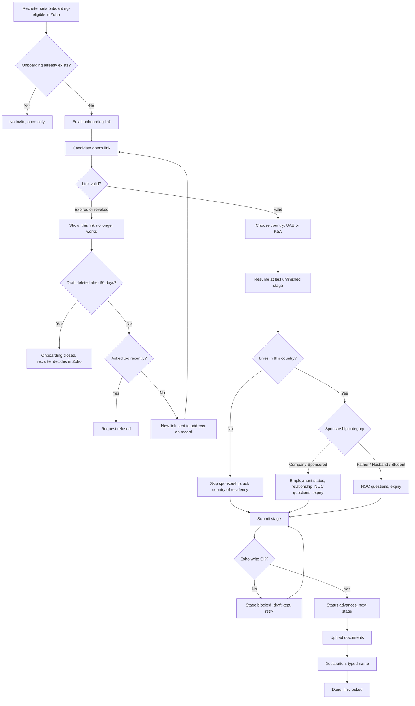

# Part 1 · Day 2 — Discovery: Exploring an Unfamiliar Web Portal

**Date completed:** 2026-11-04 · **Time spent:** ~9 hours

**Practice system:** EventLab candidate onboarding portal, studied from its internal project spec (not included in this repo)

## Success criteria

| Criterion (copied from the planner) | Done? | Evidence (link or section below) |
| --- | --- | --- |
| Approaches an unfamiliar system methodically | Yes | [Method](#method) · [How I approached the portal](#approach) |
| Maps a real portal's flows, inputs and branches | Yes | [Exercise 1: main flow, diagram, branches, inputs](#exercise-1) |
| Distinguishes field meaning from field extraction | Yes | [Meaning vs extraction](#meaning-vs-extraction) · [Exercise 2](#exercise-2) |
| Documents click path, format and empty-state for real fields | Yes | [Exercise 2: three fields](#exercise-2) |

## Key learnings

<a id="method"></a>

### Approaching an unfamiliar system methodically

Clicking or reading at random leaves an impression, not a map. I followed a fixed order instead:

| Step | What I do | Output |
| --- | --- | --- |
| 1. Recon | Understand what the system is for and who uses it | Summary and actors |
| 2. Map the structure | Identify the parts and how they hand off | Flow outline |
| 3. Walk the happy path | Follow one user through the main task | Numbered steps |
| 4. Find the branches | Look for every condition that changes what happens next | Branch table |
| 5. Probe the inputs | List each input, when it's shown, and its rules | Inputs table |
| 6. Check empty states | Ask "what does nothing look like here?" | Empty-state rules |
| 7. Log unknowns | Write down what isn't defined instead of guessing | Open questions |

### Mapping flows, inputs, fields and branches

- **Flow:** the step-by-step path through the main task.
- **Inputs:** what the user enters at each step and the rules on it.
- **Branches:** the points where the path splits on a condition.

Mapping all three before writing anything stops the spec from describing only the happy path instead covers postive, negative, edge and other cases

<a id="meaning-vs-extraction"></a>

### Field meaning vs field extraction

| | Field **meaning** | Field **extraction** |
| --- | --- | --- |
| Answers | *What is this?* | *How do I get it, reliably, every time?* |
| Covers | A definition | Click path, exact location, format, empty-state |
| Audience | Business stakeholders | Developers, testers, integrations |
| If missing | People misunderstand | Wrong field read, blanks treated as values |

Three patterns stood out in the portal:

1. **Same field, different labels.** *Emirates ID* (UAE) and *Iqama* (KSA) are one field in the system.
2. **Look-alike fields.** Zoho has both `EID_Number` and `Visa_Number`; only `Visa_Number` is used.
3. **Look-alike dates.** Residency permit expiry and sponsorship expiry sound alike but are separate answers.

## Exercises

<a id="approach"></a>

### How I approached the portal

I read the spec in this order, so I understood *why* and *who* before *how*:

```
Problem statement  → what troubles a lot today
Solution           → the whole journey in one paragraph
User stories       → needs of candidate, recruiter, client, engineer
Implementation     → components, sign-in, sponsorship rules, Zoho fields
Testing decisions  → every branch the system must handle with data and functionalities
Out of scope       → what NOT to assume exists
```

**Recon result:** a recruiter marks a candidate onboarding-eligible in Zoho Recruit. The candidate gets an emailed link, picks their country, completes the form stage by stage on their phone/tab/laptop, uploads documents and types a declaration. Each finished stage is updated to Zoho straight away via sync jobs.

| Actor | Role |
| --- | --- |
| Candidate | Opens link, fill the onboarding stages, uploads documents, signs declaration |
| Recruiter | Sets onboarding-eligible in Zoho, can revoke a link, track progress in Zoho |
| Zoho Recruit | Starts the process; receives every finished stage |
| Resend | Sends invite and fresh-link emails |

<a id="exercise-1"></a>

### Exercise 1: Main onboarding flow end to end

**Steps**

| # | Actor | Action | System response |
| --- | --- | --- | --- |
| 1 | Recruiter | Sets candidate to onboarding-eligible in Zoho | Arrives through the existing Zoho sync |
| 2 | System | Checks whether an onboarding already exists | No → sends link by email. Yes → no second invite |
| 3 | Candidate | Opens link on phone | No account or code needed; link checked for expiry and revocation |
| 4 | Candidate | Chooses country | Only UAE and KSA offered; fill that country's form |
| 5 | Candidate | Completes a stage | Errors shown per field; required fields marked |
| 6 | System | Saves the stage | Draft saved first, then written to Zoho |
| 7 | System | Zoho write succeeds | `Candidate_Status` advances; next stage opens |
| 8 | Candidate | Uploads documents | Filed in Zoho as Passports, ID card, Photo, NOC or Visa and etc |
| 9 | Candidate | Reads declaration and types full name | Statement, name and time recorded |
| 10 | System | Completes onboarding | Final status set in Zoho; link locked |

**Flow diagram with branches**



**Branches**

| Decision point | What happens |
| --- | --- |
| Onboarding already exists? | Yes → never invited again, however often the status re-syncs |
| Link valid? | Expired and revoked show the same message and reveal nothing about the candidate |
| Fresh link request | Sent only to the email on record; refused if asked too recently or if the draft has been deleted |
| Lives in this country? | No → the whole sponsorship section is skipped |
| Sponsorship category | Company Sponsored asks extra questions (employment status, relationship with company) |
| UAE only | Free Zone or Mainland asked under both categories |
| Zoho write fails | Stage blocked, nothing typed is lost, candidate can retry |

**Inputs (residency section, the most branched part)**

| Input | Shown when | Rule |
| --- | --- | --- |
| Lives in this country? | Always | Yes / No |
| Country of residency | Answer is No | Required |
| Sponsorship category | Answer is Yes | Company Sponsored or Father / Husband / Student |
| Free Zone / Mainland | Yes + UAE | Required for both categories |
| Sponsorship expiration date | Answer is Yes | Separate from residency permit expiry |
| Relationship with the company | Company Sponsored | Required |
| Employment status | Company Sponsored | Exactly one of five values |
| Can you get an NOC? + how long | Answer is Yes | Wording differs by country |
| Sponsor name | Answer is Yes | Required |

**UAE vs KSA**

| Item | UAE | KSA |
| --- | --- | --- |
| National ID label | Emirates ID | Iqama |
| Free Zone / Mainland | Asked | Not asked |
| NOC question under Father / Husband / Student | "Can you get an NOC immediately?" + timeline | "Can you get an NOC from sponsor?" |

<a id="exercise-2"></a>

### Exercise 2: Three fields (click path, format and empty-state)

**Field 1: National ID Number (Emirates ID / Iqama)**

| Aspect | Specification |
| --- | --- |
| **Meaning** | The candidate's national ID number in the country they are onboarding for |
| **Click path** | Onboarding link → choose country → Personal Information stage → national ID field |
| **Screen label** | *Emirates ID* (UAE) or *Iqama* (KSA) |
| **Where it is stored** | Zoho candidate record → `Visa_Number`, with `Visa_Type` = `National ID (Emirates ID / Iqama)`, expiry in `Visa_Expiry_Date` |
| **Format** | Text. Keep as text so separators and leading digits are not lost |
| **Empty-state** | Required on the form, so the stage can't be submitted without it. Blank in Zoho means the candidate hasn't finished that stage; check `Candidate_Status` |
| **Watch out** | `EID_Number` is not used for either country. Empty there means nothing |

**Field 2: Sponsorship Expiration Date**

| Aspect | Specification |
| --- | --- |
| **Meaning** | When the candidate's sponsorship arrangement ends |
| **Click path** | Onboarding link → choose country → Residency stage → "Do you live in this country?" **Yes** → choose sponsorship category → Expiration Date |
| **Where it is stored** | New Zoho custom field, still to be created by a Zoho admin. Its system name (`api_name`) is only known after creation |
| **Format** | Date |
| **Empty-state** | **Non-resident:** never shown, never written; blank means *not applicable*. **Resident:** required. **Field not created in Zoho yet:** cannot be saved; a setup prerequisite |
| **Watch out** | Not the same as Residency Expiry / Iqama Expiry. Never copy one into the other |

**Field 3: Employment Status**

| Aspect | Specification |
| --- | --- |
| **Meaning** | The candidate's employment situation with their sponsoring company |
| **Click path** | Onboarding link → choose country → Residency stage → lives in country **Yes** → category **Company Sponsored** → Employment status |
| **Allowed values** | Exactly one of: Currently employed / Made redundant permanently / Temporarily redundant / Family Owned / Others (please specify) |
| **Where it is stored** | New Zoho custom picklist, still to be created by a Zoho admin |
| **Format** | One picklist value. Zoho doesn't check picklist values, so the portal refuses anything outside the five |
| **Empty-state** | **Non-resident:** not asked. **Father / Husband / Student:** not asked. **Company Sponsored:** required |
| **Watch out** | The original Word form showed six checkboxes, with "Made redundant permanently" printed twice by mistake. The portal drops the duplicate and allows one answer only |

**Empty is not one thing**

| Field | Blank could mean | How to tell |
| --- | --- | --- |
| National ID | Stage not finished yet | `Candidate_Status` |
| Sponsorship expiry | Non-resident, or stage not finished | Residency answer + `Candidate_Status` |
| Employment status | Non-resident, Father/Husband/Student, or stage not finished | Residency + category + `Candidate_Status` |

One general rule from the spec: **a blank optional field sends no write to Zoho, not an empty one.** So a blank in Zoho can also mean "Zoho kept its old value."

## Reflection

I used to think "empty" was a single, static state. It isn’t. Two of my three fields remain blank for most candidates by design. Residency and sponsorship answers hide them. A blank value needs context before it means anything.

Then there are look-alike fields. Finding both `EID_Number` and `Visa_Number` in Zoho was a wake-up call. The extraction rule often boils down to this simple question: which of these is the real one?

Next time, I’ll read the testing section of a spec first. It listed almost every branch I later mapped. This connects directly to my work on the EventLab project. Field mapping to Zoho is exactly where these questions come up.

## AI use

I used Claude to help read the onboarding spec, structure this file to the COE template, draft the tables and the Mermaid flow diagram, and check that the diagram renders.

What I corrected or changed along the way:
- I removed sections that went beyond the success criteria.
- The Mermaid diagram didn't render cleanly at first; it was rewritten and re-checked.

## Open questions
1. Raising unknowns. SYou hit gaps during discovery. Do you flag them with stakeholders immediately, or bundle them up and share everything at once?

## Changes after review