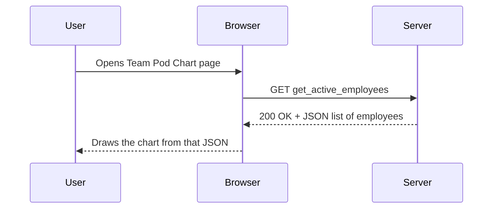
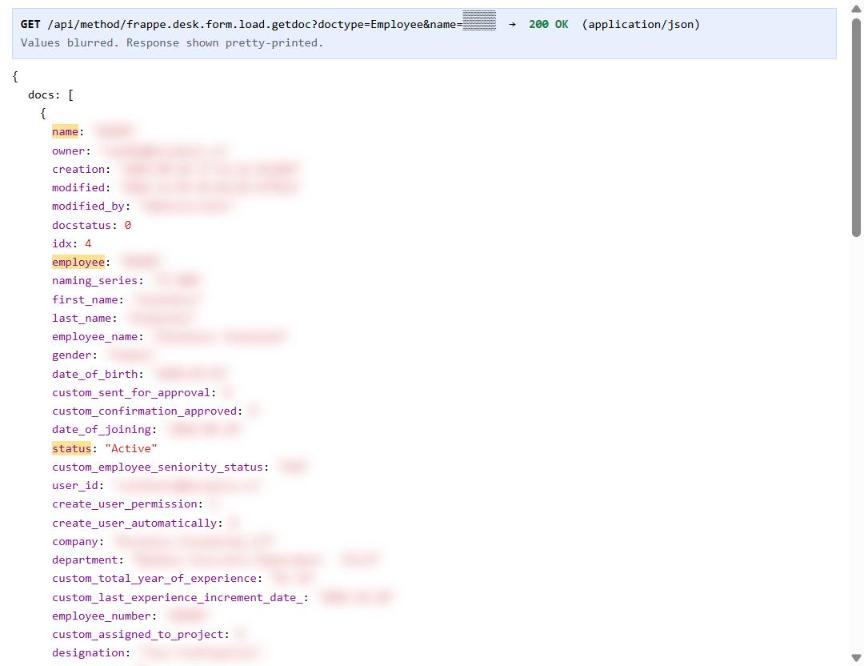

# Part 1 · Day 3 — Web Application Fluency: Reading What a Page Actually Does

**Date completed:** 2026-11-05 · **Time spent:** ~ 5 hours

**Practice system:** Incubyte ERP (Frappe), inspected with Chrome DevTools. All values shown are dummy or blurred.

**Why not the Day 2 portal:** the EventLab onboarding portal is a completed client project that I no longer have access to, so I used the ERP's employee data instead. It holds the same kind of fields I documented on Day 2 and its have some mutual functionality such employee , HR and etc.

## Success criteria

| Criterion (copied from the planner) | Done? | Evidence (link or section below) |
| --- | --- | --- |
| Understands how a web application serves data via requests and responses | Yes | [Requests and responses](#requests-responses) |
| Uses the Network tab to inspect real requests | Yes | [Exercise 1: three real requests](#exercise-1) |
| Reads a JSON response and recognises its structure | Yes | [Reading JSON](#reading-json) · [Exercise 2: structure of each response](#exercise-2) |
| Finds the request carrying the data documented on Day 2 | Partly | [Exercise 3](#exercise-3): EventLab portal not accessible; found the requests carrying the equivalent fields (ID, employment status, expiry date) in the ERP |

## Key learnings

<a id="requests-responses"></a>

### How a web application serves data

A page doesn't hold its data. The browser asks the server for it, and the server answers.



| Part | What it tells me | Example from the ERP |
| --- | --- | --- |
| URL | Which data is being asked for | `.../api/method/incubyte_ui.api.profile.get_employee_details` |
| Method | Read or change | `GET` = read; `POST` / `PUT` = send or save |
| Status code | Whether it worked | `200` OK; a denied page shows "Access Denied" |
| Response | The data itself | JSON |

### Using the Network tab

Hit F12 and jump to the **Network** tab. Filter for **Fetch/XHR** requests to cut through the noise of images, styles, and scripts. Clear the log, then trigger the page and click a specific row. The **Headers** panel lays out the URL, method, and status code. **Preview** breaks the response down into an expandable tree, while **Response** serves up the raw text.

<a id="reading-json"></a>

### Reading JSON

| Symbol | Meaning |
| --- | --- |
| `{ }` | An object: named fields, `"field": value` |
| `[ ]` | A list of items, usually objects of the same shape |
| `"text"` | A string, including dates like `"2024-01-15"` |
| `0`, `4` | A number |
| `null` | A value that is deliberately empty |
| `""` | An empty string, which is not the same as `null` |

The data I need is rarely at the top level. Frappe wraps it in an outer layer (an "envelope"), so I first have to find where the real record sits.

## Exercises

<a id="exercise-1"></a>

### Exercise 1: Three real requests

| # | Page that triggered it | Request (path only) | Method | Status | What it carries |
| --- | --- | --- | --- | --- | --- |
| 1 | Team Pod Chart | `/api/method/incubyte_ui.api.employee_list.get_active_employees` | `GET` | `200` | List of 193 active employees, 10 fields each |
| 2 | My profile | `/api/method/incubyte_ui.api.profile.get_employee_details` | `GET` | `200` | One employee's full record, 148 fields |
| 3 | [EDIT: page you were on, e.g. my own employee record] | `/api/method/frappe.desk.form.load.getdoc?doctype=Employee&name=…` | `GET` | `200` | One Employee document, as loaded by Frappe's standard form |

Request 3, blurred:



<a id="exercise-2"></a>

### Exercise 2: Structure of each response

The three responses wrap the data differently, so the path to a field changes per request.And one point to be add here objects and fields are as per devtools side it might be the same or varies.

| # | Shape | Path to an employee's ID |
| --- | --- | --- |
| 1 | `{ message: { status, message, data: [ …193 objects… ] } }` | `message.data[i].name` |
| 2 | `{ message: { status, data: { …148 fields… } } }` | `message.data.name` |
| 3 | `{ docs: [ { …fields… } ] }` | `docs[0].name` |

**Request 1, employee list (dummy values):**

```json
{
  "message": {
    "status": "success",
    "message": "Retrieved 193 employee records",
    "data": [
      {
        "name": "E0000",
        "first_name": "Asha",
        "last_name": null,
        "employee_name": "Asha Dummy",
        "reports_to": "",
        "date_of_joining": "2024-01-15",
        "image": null,
        "designation": "Software Craftsperson",
        "pod": "Pod Flight",
        "client": "Client XYZ"
      }
    ]
  }
}
```

**Request 2, one employee's record (dummy values, 10 of 148 fields):**

```json
{
  "message": {
    "status": "success",
    "data": {
      "name": "E0000",
      "employee": "E0000",
      "status": "Active",
      "date_of_joining": "2024-01-15",
      "employment_type": null,
      "contract_end_date": null,
      "valid_upto": null,
      "passport_number": "X0000000",
      "relieving_date": null,
      "notice_number_of_days": 0
    }
  }
}
```

What I recognised in the structure:

- Request 1 wraps an outer `message` around an inner one. That inner layer just holds a text note saying "Retrieved 193 employee records." Same name, different meaning.

- The structure shifts too. Request 1 spits out a list `[ ]`. Requests 2 and 3 return single records `{ }`.

- Then there are the custom fields in Request 3. Incubyte adds these with a `custom_` prefix, like `custom_employee_seniority_status`. They sit separate from Frappe’s standard fields.

- Every record also drags along system fields. `owner`, `creation`, `modified`, and `modified_by`. These describe the record itself, not the employee.

<a id="exercise-3"></a>

### Exercise 3: Requests carrying the Day 2 kind of data

Day 2 documented an ID, an employment status and an expiry date for EventLab candidates. I found the ERP equivalents:

| Day 2 field (EventLab) | ERP equivalent | Request | JSON field | Format | When empty |
| --- | --- | --- | --- | --- | --- |
| National ID number | Employee ID | 1, 2, 3 | `name` (also `employee` in 2 and 3) | String, mostly `A9999`; a few `A-9999` or longer | Never empty in all 193 records |
| Employment status | Employee status | 2, 3 only | `status` | String, e.g. `"Active"` | Expected `null`; never seen empty. Not in the list response at all |
| Sponsorship expiry date | Passport expiry | 2 | `valid_upto` | Date string `YYYY-MM-DD` | `null` |

**Empty values in real data**

| Field | What I saw | So handle |
| --- | --- | --- |
| `reports_to` | `null` in 44 records **and** `""` in 13 | Both as empty |
| `image` | `null` in 73 records, `""` once | Both as empty |
| `last_name` | `null` for 3 people | As empty |
| Any field | Key always present, never missing | Missing key = unexpected |

**Link back to Day 2:** on Day 2 I wrote that "empty is not one thing" from reading a spec. Here I saw it in real data: the same field (`reports_to`) uses two different empty values. A developer who only checks for `null` would miss the 13 records with `""`.

## Reflection

I used to rely solely on the screen or a spec sheet. That changed when I opened the Network tab. What jumped out? [EDIT: e.g., one page fired so many requests / the same employee ID sat at a different path in every response]. The `reports_to` field was the real catch. It used both `null` and `""`. On Day 2, I could only guess at this from the documentation. Now, I can actually count it. As a BA, I’m changing my workflow. [EDIT: e.g., check the real request before writing a field spec, so I use the field names developers will see].

## AI use

I used Claude to:

- explain how requests, responses and JSON work with sample examples
- turn my findings into this file in the COE template

What I changed or corrected:

- `/desk/employee` was denied for my account, so I used the Team Pod Chart and profile requests instead. 

## Open questions

1. When I write a field spec as a BA, should I name the API field (`valid_upto`) or only the screen label (Passport expiry)?

## Changes after review

