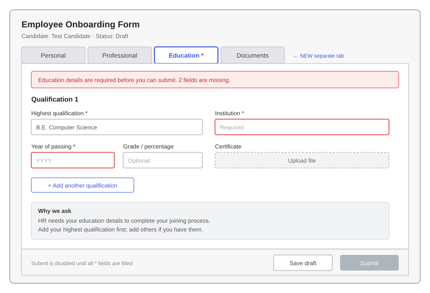

# Part 1 · Day 6 — AI-Native Working for a Business Analyst

**Date completed:** 2026-11-13 · **Time spent:** ~9 hours

**AI tool used:** Claude (Anthropic). **Material:** my own work from this week: the ERP data from [Day 3](../day3/day-03-web-application-fluency.md), the My Profile spec from [Day 4](../day4/day-04-specification-work-breakdown.md), and the HR and team-lead sessions from [Day 5](../day5/day-05-elicitation.md).

## Success criteria

| Criterion (copied from the planner) | Done? | Evidence (link or section below) |
| --- | --- | --- |
| Uses AI to explore an unfamiliar system faster | Yes | [Exercise 1: interpreting ambiguous ERP data](#exercise-1) |
| Uses AI to sketch and stress-test a specification | Yes | [Exercise 2: three alternative specs for one rule](#exercise-2) |
| Prototypes a quick mock-up to validate an idea | Yes | [Exercise 3: Education tab mock-up](#exercise-3) |
| Understands the limits of AI and owns the final precision | Yes | [Limits of AI: real examples from my week](#limits) |
| Uses AI to critique a real specification and finds remaining gaps | Yes | [Exercise 4: AI critique of my Day 4 spec](#exercise-4) |

## Key learnings

### Where AI speeds up BA work

| BA task | How AI helps | What stays with me |
| --- | --- | --- |
| Exploring an unfamiliar system | Explains unfamiliar data, summarises long transcripts, lists possible meanings of an unclear field | Checking which meaning is true, with the people who know |
| Sketching specifications | Drafts several versions of a rule quickly so I can compare them | Choosing one, and knowing who has to approve it |
| Stress-testing a spec | Plays "the developer" and asks the questions the spec doesn't answer | Deciding which questions matter and answering them |
| Prototyping | Produces a quick wireframe in minutes, before anyone writes a spec | Validating it with the actual users |

### Generating and comparing interpretations

When data is ambiguous, the dangerous move is picking the first meaning that seems obvious. AI is useful for listing **every plausible meaning** of a value, so I can then ask how each one would be checked. The output is a list of questions, not an answer.

### Prompting so the output is useful

From Anthropic's prompt engineering guide, the habits that mattered most:

- **Provide context:** explain what the system is, who uses it, and what I already know.
- **Be specific about the task:** ask to “list every way a developer could misread this rule,” rather than simply saying “review this.”
- **Include the material itself:** paste the spec or JSON instead of just describing it.
- **Request a clear structure:** a table with fixed columns is easier to check than paragraphs.
- **Ask it to distinguish facts from guesses.**

### Limits of AI: real examples from my week

AI accelerated every day this week, and it also made mistakes I only caught because I knew the material:

| Day | What the AI did | What was actually true | Caught by |
| --- | --- | --- | --- |
| 3 | Said a request came from the "Employee form" page | That page was "Access Denied" for me; it came from another page | Me, comparing with my notes |
| 3 | Called inspecting network traffic "observation" | Observation means watching a person work; this was closer to interface analysis | Review |
| 4 | Drafted ATDD course takeaways without being able to open the course | Only I could say what the course actually taught | Me, after watching it |
| 5 | Wrote that I had sent the survey form in the session | The transcript shows I only promised to send it | Checking against the transcript |
| QA 2 | Wrote test cases that read as if they came from an existing suite | They were new and never run | Me |

**What this taught me:** AI is confident whether it is right or wrong. It can't see what I saw, attend my meetings, or know what a stakeholder decided. Every fact in a spec has to be checked against a source I trust, and the final precision is my responsibility.

## Exercises

### Exercise 1: Using AI to interpret ambiguous ERP data

**Prompt (summary):** "Here are fields from an employee record in a Frappe HR system, with the values I saw. For each, list every plausible meaning, and how I could check which one is true."

| Field and value I saw | Possible meanings (AI) | How to check |
| --- | --- | --- |
| `contract_end_date: null` | (a) permanent employee, no end date · (b) contract employee whose date wasn't entered · (c) field not used at Incubyte | Ask HR; compare with `employment_type` for the same people |
| `notice_number_of_days: 0` | (a) genuinely no notice period · (b) never set, and 0 is the default · (c) only filled when someone resigns | Ask HR. **Insight:** a default of `0` can hide "empty" just like `null` does |
| `employment_type: null` | (a) not filled in · (b) everyone is full-time, so nobody fills it · (c) set somewhere else, e.g. on the contract | Ask HR; check the field's options in the ERP |
| `custom_employee_seniority_status` | (a) seniority band (e.g. junior, senior) · (b) probation or confirmation status · (c) an internal label for reviews | Its `custom_` prefix means Incubyte added it; ask the ERP team what it's for |
| "My Assignments" shows 0 | (a) I have no assignments · (b) the feature isn't used for my role · (c) it's for candidate reviews, not employees | Day 5: neither HR nor the lead knew; ask the ERP team |

**What AI added:** in minutes I had 15 possible meanings to rule in or out, instead of quietly assuming one. The `notice_number_of_days: 0` row extends my Day 2 and Day 3 lesson: **empty isn't only `null` and `""`; a default value can hide it too.**

### Exercise 2: Sketching alternative specs to stress-test one rule

My Day 4 **Rule 5** assumed an expired passport is *flagged* on the profile, and the gap ledger marked it a **Blocker**. I asked the AI to sketch alternative versions of the rule.

| Version | Rule | What it would need | Risk |
| --- | --- | --- | --- |
| A (my Day 4 spec) | Show the date with an "Expired" label | Today's date compared on screen | Employee only finds out if they open their profile |
| B | Email the employee and HR 30 days before expiry, and on the day | A daily job, email templates, a decision on who receives it | Bigger feature; needs HR's process for renewals |
| C | Show the date only, no label | Nothing extra | Expired passports go unnoticed |

**What the stress-test showed:** these aren't wording choices; they're **three different features**, which confirms gap 4 is a true Blocker. Version B also raised a question my spec never asked: **whose "today"?** An employee in India and a server elsewhere can disagree on the date near midnight.

**My call:** keep version A in the spec as the assumption, and take A vs B to HR as one sharp question.

### Exercise 3: A quick mock-up to validate an idea

In my [Day 5](../day5/day-05-elicitation.md) session, HR's #1 fix was a **separate, mandatory Education tab** on the onboarding form. Before writing a spec, I asked the AI to sketch a wireframe of the idea:

**What the mock-up shows:** Education as its own tab, required fields marked `*`, an error banner, Submit disabled until required fields are filled, room for more than one qualification, and a short "why we ask" note (the tooltip HR asked for).

**Questions it raised before any spec was written:**

1. Is education mandatory for **every** hire, including experienced hires and contractors?
2. Which fields are mandatory: institution and year, or the certificate upload too?
3. Should candidates be able to **save a draft** with education missing, or is that what causes the skipped fields today?
4. Is one qualification enough, or does HR need all of them?

**Next step:** show the wireframe to HR and ask these four questions. That's quicker than reviewing a written spec, and question 1 is already [Exercise 2, question 1](../day5/day-05-elicitation.md#exercise-2) from Day 5.

### Exercise 4: AI critique of my Day 4 specification

**Prompt (summary):** "You are the developer about to build this spec. List every question you would still have to ask before building it. For each, say which rule it affects and how serious it is."

| # | Question the AI raised | Rule | My call |
| --- | --- | --- | --- |
| 1 | Whose "today" decides "Expired": the employee's time zone or the server's? | 5 | **Accept:** add to gap 4 |
| 2 | What does a masked passport number look like if it's shorter than 4 characters, or empty? | 7 | **Accept:** add a scenario; empty shows "Not provided", not "••••" |
| 3 | What initials does the avatar show when there's no last name ("Asha")? | 3 | **Accept:** add a scenario: show "A" |
| 4 | Is a value of only spaces (`"  "`) treated as empty? | 3 | **Accept:** treat as empty, like `null` and `""` |
| 5 | How long is "does not respond" before the error appears? | 6 | **Accept:** add to gap 5 for the developers to propose |
| 6 | What if *some* fields load and others fail? | 6 | **Accept:** new gap, Blocker-level |
| 7 | Contract end date is in the field spec, but no rule says how it's shown | Field spec | **Accept:** add a rule, or remove it from scope |
| 8 | How does a 20-character ID fit on a phone screen: wrap or scroll? | 2 | **Ask:** a design decision |
| 9 | Rule 1 says employees can't see others' profiles, but Day 5 showed they can see others' leaves today. Which is the target? | 1 | **Accept:** my spec covers the profile only; flag the leaves issue as separate |
| 10 | Should the rules be split into smaller stories? | All | **Reject:** it's one screen; splitting would add overhead |

**Result:** the AI found **9 gaps worth acting on** in a spec I thought was complete, including two (1 and 6) that affect what gets built. The tenth was a fair question but not right for this spec, which is why every suggestion still needs my judgement.

## Reflection

I thought my Day 4 spec was finished, but when I asked AI to review it from a developer’s perspective, it still found nine actionable gaps—two of which would change what gets built. Thinking through every possible meaning of an unclear field also changed how I look at data: `notice_number_of_days: 0` showed me that a default value can mask “empty” just as easily as null can. The wireframe surprised me most. In just a few minutes, it turned HR’s idea into four pointed questions, before I’d written a single line of the spec. But I also caught AI making confident mistakes throughout the week, from sending a request to the wrong page to referring to a survey I’d only said I would send. AI helps me work faster, but it’s still my job to check every fact against what I actually saw and heard.

## AI use

It also helped me organize this file.

## Open questions

1. When AI critiques a spec, how do we stop the list of questions from growing without end?

## References

- [Anthropic: Prompt engineering overview](https://docs.anthropic.com/en/docs/build-with-claude/prompt-engineering/overview)
- [Incubyte: AI adoption videos](https://www.youtube.com/@incubyte_co/videos)

## Changes after review

- None yet.
