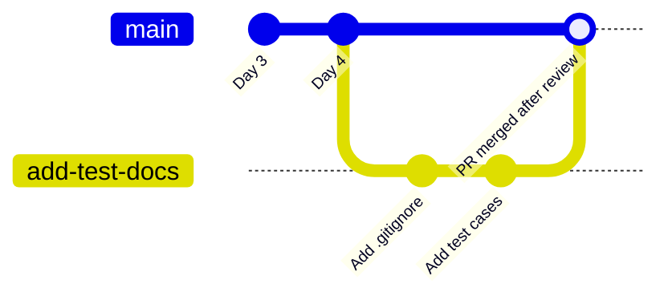

# Part 1 · Day 2 — Git & Version Control for QA

**Date completed:** 2026-11-10 · **Time spent:** ~9 hours

**Practice repo:** my own COE repo, [Vaishnavi_BA-DXC-COE](https://github.com/VaishnaviV-new/Vaishnavi_BA-DXC-COE), which I have been using every day since 2 Nov 2026.

## Success criteria

| Criterion (copied from the planner) | Done? | Evidence (link or section below) |
| --- | --- | --- |
| Creates GitHub account and understands basics | Yes | [Exercise 1: my account and repo](#exercise-1) |
| Successfully clones and commits to repository | Yes | [Exercise 1](#exercise-1) · [Exercise 2: my commit history](#exercise-2) |
| Writes clear commit messages for test changes | Yes | [Exercise 2: commit messages](#exercise-2) · [Commit message rules](#commit-messages) |
| Understands branching and pull requests | Partly | [Branches and PRs](#branches): I understand the workflow, but all my work so far is on `main`. First branch and PR planned in [Exercise 4](#exercise-4) |
| Creates README with test documentation in Markdown | Partly | My [README index](../../README.md) and [Exercise 3: test cases in Markdown](#exercise-3). A README dedicated to test documentation is planned in [Exercise 4](#exercise-4) |
| Collaborates using GitHub (fork, PR, review) | No | Not done yet; my plan is in [Exercise 4](#exercise-4) |

## Key learnings

### Why version control matters for QA

- Tests evolve with the app. When a feature shifts, so do its test cases. Git keeps both in lockstep, tracking exactly who changed what and why. You can also roll back. If a test change wrecks the suite, the last working version is just one step away. 

- Tests get reviewed like code. A pull request lets someone vet a test before it’s trusted. One source of truth. No more "final_v3_test_cases.xlsx" bouncing around in email. Everyone works from the same repo.

### Git fundamentals

| Command | What it does | When I used it |
| --- | --- | --- |
| `clone` | Copies a repository from GitHub to my computer | Setting up my COE repo locally |
| `add` (stage) | Picks which changes go into the next commit | The **+** button in VS Code Source Control |
| `commit` | Saves a snapshot of staged changes with a message | Every COE day |
| `push` | Sends my commits to GitHub | **Sync Changes** in VS Code |
| `pull` | Brings GitHub's changes down to my computer | After editing a file directly on GitHub |

### Branches and pull requests

A **branch** is a separate line of work. I can change things on it without touching `main` until the change is reviewed. A **pull request (PR)** asks to merge a branch into `main`; teammates review it, comment and approve before it goes in.

A **fork** is my own copy of someone else's repository on GitHub. I change my fork freely, then open a PR to propose the change back to the original.

### Collaborative workflow for QA teams

1. Pull the latest `main`.
2. Create a branch for one change, e.g. `add-profile-empty-state-tests`.
3. Commit in small steps with clear messages.
4. Push the branch and open a PR describing what the tests cover.
5. A teammate reviews; I fix anything they raise.
6. Merge only when reviewed and the tests pass.

### `.gitignore` for test artifacts

Some files should never be committed: they're generated on every run, large, or secret.

| Ignore | Why |
| --- | --- |
| `test-results/`, `playwright-report/`, `reports/` | Regenerated on every test run |
| `screenshots/`, `videos/` | Large files from failed tests |
| `__pycache__/`, `.pytest_cache/` | Python caches |
| `*.log` | Run logs |
| `.env` | Passwords and tokens; must never be pushed |

### Clear commit messages

- **Start with a verb:** Add, Fix, Update, Remove.
- **Say what changed, not that something changed:** "Fix wrong expected value in TC-02" beats "fixed test".
- **One change per commit,** so each one can be understood or undone on its own.
- **Keep the first line short** (about 50 characters); add detail on later lines if needed.

### README and Markdown for test documentation

A README is the first thing anyone sees in a repository. For a test project it should say what is tested, how to run the tests, and where the results go. Markdown keeps test documentation readable on GitHub and reviewable in a PR: tables for test cases, headings for sections, code blocks for commands.

## Exercises

### Exercise 1: My GitHub account and repository

| | |
| --- | --- |
| Account | [VaishnaviV-new](https://github.com/VaishnaviV-new) |
| Repository | [Vaishnavi_BA-DXC-COE](https://github.com/VaishnaviV-new/Vaishnavi_BA-DXC-COE) |
| Local copy | Connected to GitHub and worked on in VS Code |
| Structure | One folder per track, one folder and Markdown file per day, shared `assets/` for images, README as an index |

### Exercise 2: Real commits, and a real problem I fixed

**Some of my commit messages**

| Commit message | Why it's clear |
| --- | --- |
| `Add Part 1 Day 3: web application fluency` | Verb first; says exactly which day was added |
| `Update README index with Day 2` | Says what changed and why |
| `Add QA Day 1: automation fundamentals and update README` | Covers both changes in that commit |
| `Revise reflection on workflow changes and data insights` | Made on GitHub; describes the content change |

I also kept commits **one per day**: for Day 3 and QA Day 1, I unstaged the README from the first commit and committed it with the second, so each commit matched one piece of work.

**Problem: "divergent branches" when syncing**

| Step | What happened |
| --- | --- |
| Cause | I edited my Day 3 file directly on GitHub, then committed Day 4 in VS Code. GitHub and my computer each had a commit the other didn't |
| Error | `fatal: Need to specify how to reconcile divergent branches.` |
| Fix | `git pull --rebase origin main` placed my Day 4 commit on top of the GitHub edit, then `git push` |
| Result | Pushed successfully (`a3e2d12..66ef31f main -> main`) |
| Prevention | `git config pull.rebase true`, so future syncs rebase automatically |

What I learned: always pull before working locally if I've edited anything on GitHub.

### Exercise 3: Test documentation in Markdown

To practise documenting tests in Markdown, I wrote these test cases for this exercise, turning my BA Day 4 acceptance criteria for the ERP My Profile screen into test-case form[BA Day 4 acceptance criteria](../../BA-DXC/day4/day-04-specification-work-breakdown.md).

Status: written as documentation only. They live in this file, not in a separate test repository, and they have not been run against the ERP. TC-04 and TC-05 would also need test setup (changing a passport expiry date, blocking a network request) that I don't have access to.

| ID | Title | Steps | Expected result | Type |
| --- | --- | --- | --- | --- |
| TC-01 | View own profile | Sign in as employee E0000 → open My Profile | Name, ID, status and joining date shown | Functional |
| TC-02 | No reporting manager (stored as null) | Open a profile whose manager is null | Reporting manager reads "Not provided" | Functional – empty state |
| TC-03 | No reporting manager (stored as "") | Open a profile whose manager is empty text | Reporting manager reads "Not provided" | Functional – empty state |
| TC-04 | Passport expires today | Set expiry to today → open My Profile | Date shown with "Expired" | Functional – boundary |
| TC-05 | Profile fails to load | Block the profile request → open My Profile | Error with "Try again"; no field reads "Not provided" | Functional – failure |

Those above testcase are not avilable in any of the resp

### Exercise 4: Fork, branch, pull request and review (planned)

**Status: not done yet.** I haven't had a fork, PR or review set up so far; all my COE work has been committed straight to `main`. This is my plan, and I'll update this section under *Changes after review* once it's done.

| Step | Plan |
| --- | --- |
| Fork | Fork GitHub's practice repository `octocat/Spoon-Knife` |
| Branch | Clone my fork and create a branch `add-test-docs` |
| `.gitignore` | Add one for test reports, screenshots, caches and `.env` |
| Test documentation | Add a `README.md` with the test cases from [Exercise 3](#exercise-3) |
| Commits | Two commits: `Add .gitignore for test reports, screenshots and caches` and `Add README with test cases for My Profile` |
| Pull request | Open a PR into my fork's `main`, describing what the test cases cover |
| Review | Ask a colleague to review, respond to comments, then merge |

## Reflection

I learned Git through daily COE submissions rather than tutorials, so the commands quickly became part of my routine instead of just theory. The biggest lesson came from a divergent-branches error: I’d edited files on GitHub and in VS Code at the same time, creating two separate histories. Now I know to pull before making changes and leave rebase enabled. Committing one change at a time has also made my history much easier to follow and review. I haven’t used branches or pull requests yet, but I think that’ll be the biggest adjustment when I start working on a shared test suite, where each test change should be reviewed before it reaches main.

## AI use

I used Claude to explain Git concepts and to guide me through VS Code and GitHub as I submitted my COE days, including diagnosing the divergent-branches error. I ran every command and commit myself. Claude helped structure this file in the COE template.

## Open questions

1. Should test cases live in the same repository as the application code, or in a separate test repository?

## References

- [GitHub Docs: Get started](https://docs.github.com/en/get-started)
- [YouTube: Git and GitHub for Beginners](https://www.youtube.com/watch?v=RGOj5yH7evk)
- [GitHub Skills](https://skills.github.com/)
- [Visualizing Git](https://git-school.github.io/visualizing-git/)

## Changes after review

